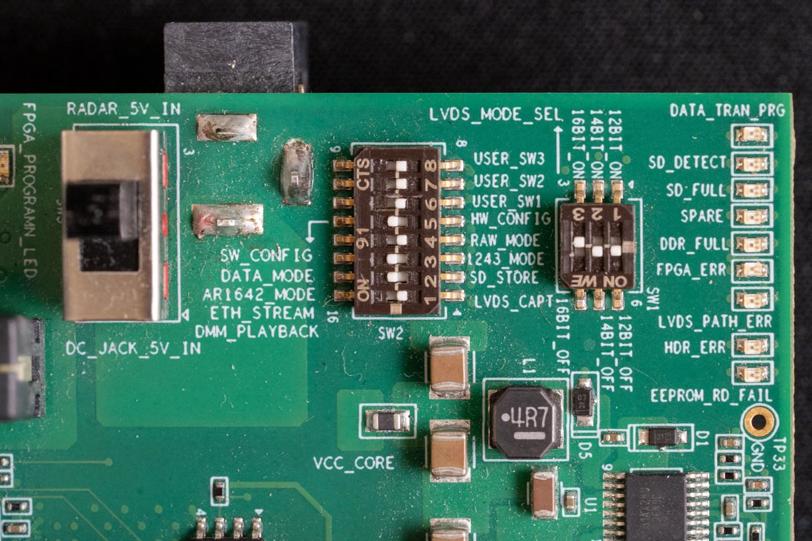
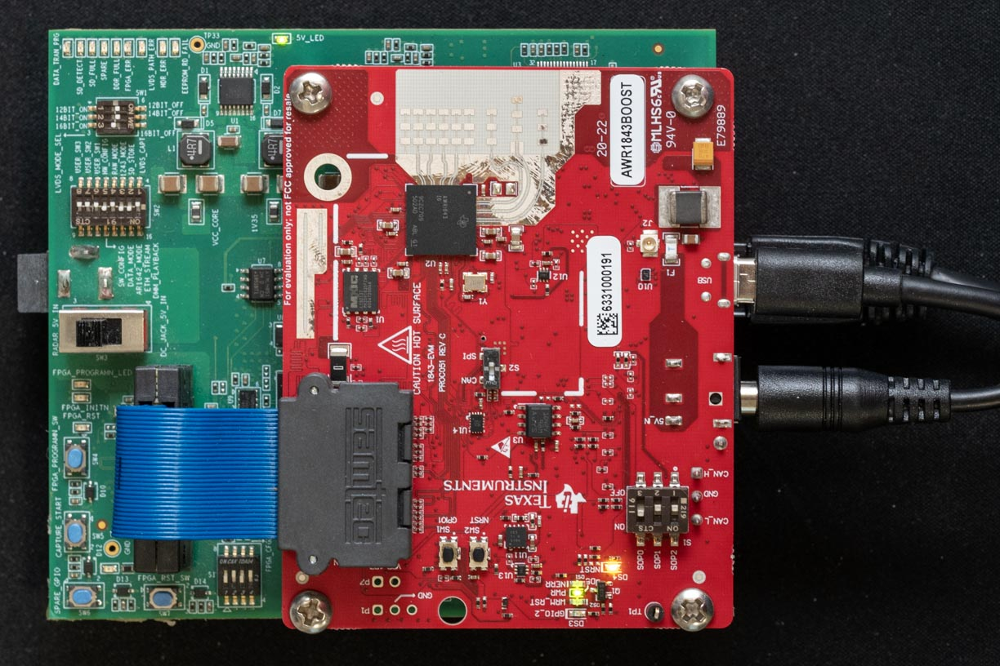
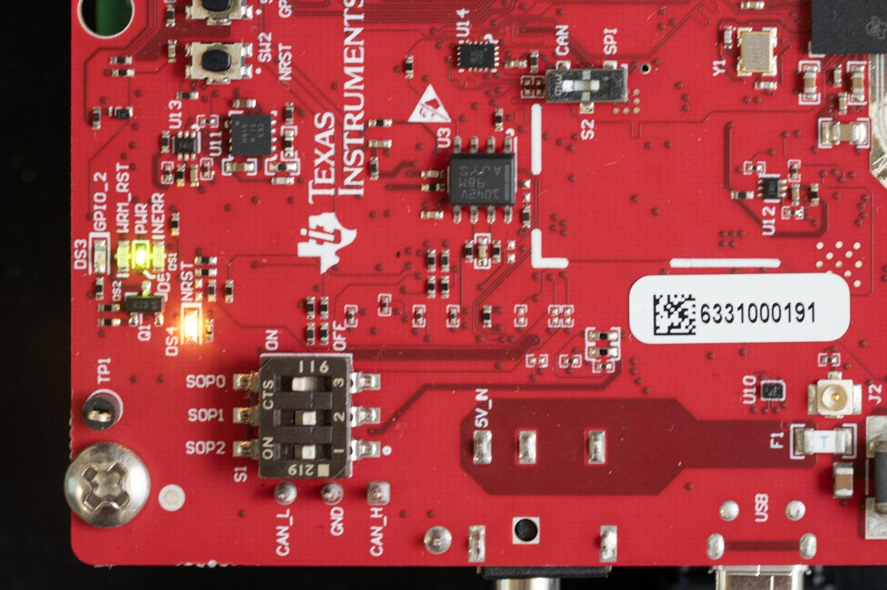
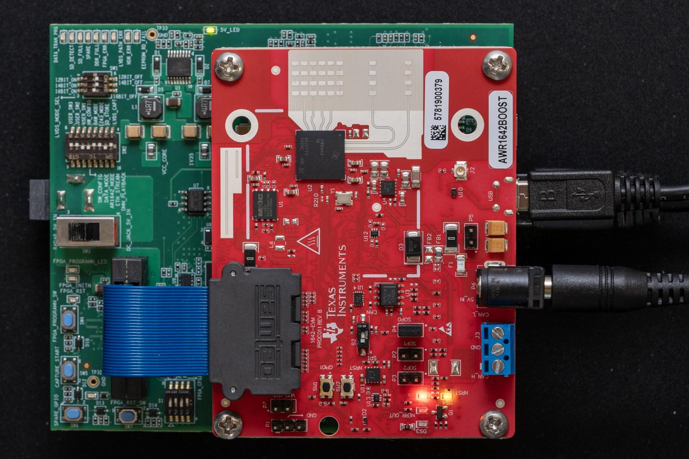
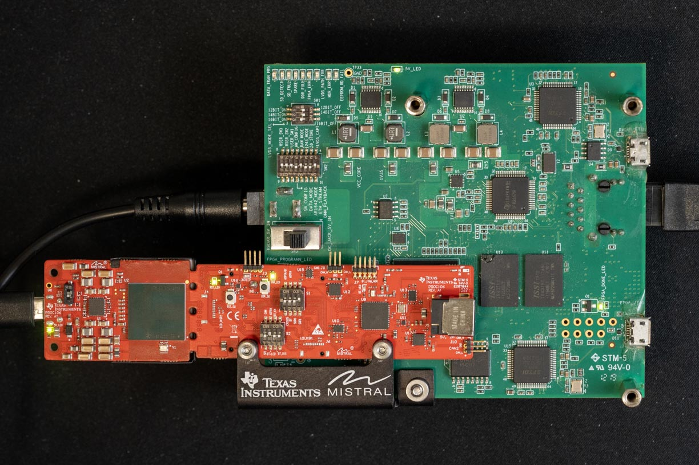
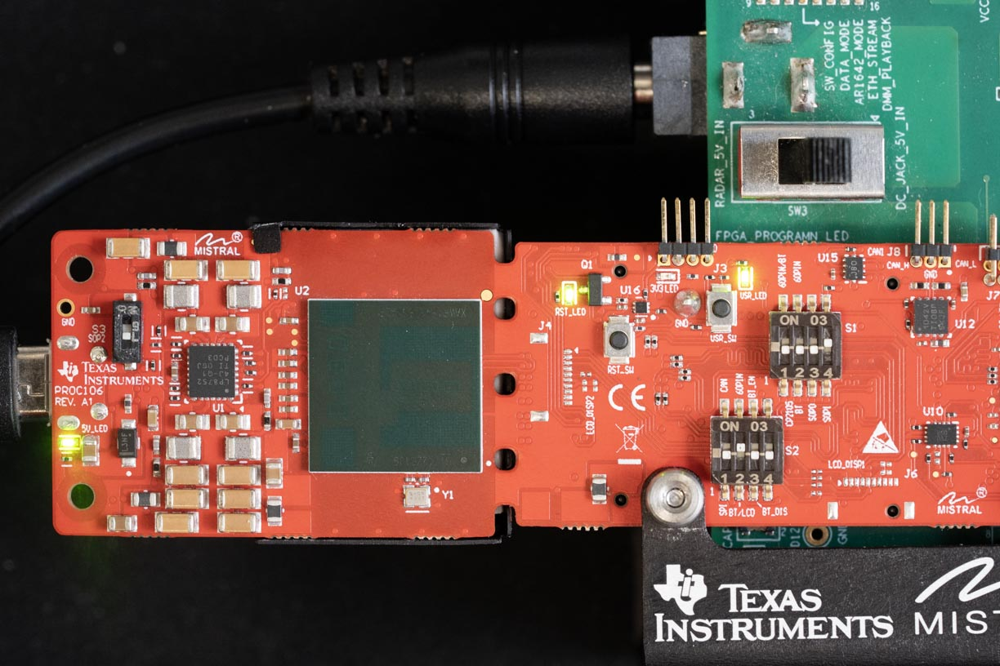

# Hardware Setup

!!! abstract "TL;DR"

    A mmWave radar I/Q data collection system consists of two parts:

    1. A radar with a Low Voltage Differential Signaling (LVDS) debug port which dumps out raw data, and
    2. A capture card which translates these LVDS signals into ethernet packets.

    To use these components with our [`radar`][xwr.radar] and [`capture`][xwr.capture] interfaces, the radar needs to be flashed with firmware with LVDS streaming enabled, while the capture cards need to be configured to read the output signals.

All supported radars follow the same basic procedure: set the radar's SOP pins to flashing mode, flash the demo firmware, and then set the SOP pins back to functional mode. The radars are grouped by the TI SDK which provides their firmware.

| Radar | SDK | Flashing Tool | Power | SOP Pins |
| ----- | --- | ------------- | ----- | -------- |
| [AWR1843Boost](#awr1843boost) | [mmWave SDK](#mmwave-sdk-radars) | UniFlash | 5V | DIP switches |
| [AWR1642Boost](#awr1642boost) | [mmWave SDK](#mmwave-sdk-radars) | UniFlash | 5V | Jumpers |
| [AWR1843AOP](#awr1843aop) | [mmWave SDK](#mmwave-sdk-radars) | UniFlash | 5V | DIP switches |
| [AWR2944EVM](#mmwave-mcu-plus-sdk-radars) | [mmWave MCU Plus SDK](#mmwave-mcu-plus-sdk-radars) | UniFlash | 12V | Jumpers |
| [AWR2944PEVM](#mmwave-mcu-plus-sdk-radars) | [mmWave MCU Plus SDK](#mmwave-mcu-plus-sdk-radars) | `uart_uniflash.py` | 12V | Jumpers |
| [AWR2E44PEVM](#mmwave-mcu-plus-sdk-radars) | [mmWave MCU Plus SDK](#mmwave-mcu-plus-sdk-radars) | `uart_uniflash.py` | 12V | Jumpers |
| [AWRL6844EVM](#mmwave-l-sdk-radars) | [mmWave L-SDK](#mmwave-l-sdk-radars) | UniFlash | — | DIP switches |

## DCA1000EVM Capture Card

!!! danger "ESD Sensitive"

    In our experience, the DCA1000EVM is particularly fragile; be careful with electrostatic discharge (ESD).

{: style="width: 50%"}

Ensure that the following DIP switches are set:

- SW2.5: `SW_CONFIG`
- SW2.6: `USER_SW1` (the marked right side), unless the EEPROM is messed up from a misconfigured [`configure_eeprom`][xwr.capture.DCA1000EVM.configure_eeprom] call.

The `DC_JACK_5V_IN` (the large switch on the side) should also be set, depending on whether the FPGA will be powered via the DC jack or via the radar.

!!! tip

    For the AWR1843Boost and AWR1642Boost, setting the large power switch to `RADAR_5V_IN` allows a single power supply connected to the radar to power the entire system.

??? info "Hardware Configuration Switches (Optional)"

    The following are configured by [`configure_fpga`][xwr.capture.DCA1000EVM.configure_fpga] under normal operation, but can be manually set in case that isn't working:

    - SW1: 16-bit mode (`16BIT_ON`, `14BIT_OFF`, `12BIT_OFF`).
    - SW2.1: `LVDS_CAPTURE`
    - SW2.2: `ETH_STREAM`
    - SW2.3: `AR1642_MODE` (2-lane LVDS)
    - SW2.4: `RAW_MODE`
    - SW2.5: `HW_CONFIG`

## mmWave SDK Radars

After installing the [mmWave SDK](https://www.ti.com/tool/MMWAVE-SDK), the firmware can be found at the following paths in the install directory:

| Radar | Firmware | UniFlash Device | Serial Port |
| ----- | -------- | --------------- | ----------- |
| AWR1843Boost | `demo/xwr18xx/mmwave/xwr18xx_mmw_demo.bin` | `AWR1843Boost` | `XDS110 Class Application/User UART` |
| AWR1642Boost | `demo/xwr16xx/mmwave/xwr16xx_mmw_demo.bin` | `AWR1642Boost` | `XDS110 Class Application/User UART` |
| AWR1843AOP | `demo/xwr18xx/mmwave/xwr18xx_mmw_aop_demo.bin` | `AWR1843` | `Silicon Labs Dual CP2105 USB to UART Bridge: Enhanced` |

1. Prepare for flashing.

    - Connect a micro-USB cable to the port on the radar, and power the radar on by connecting its power supply.
    - Set the radar to flashing mode (`SOP2:0=101` on the AWR1843Boost and AWR1642Boost); see the radar-specific instructions below.

2. Flash using [TI UniFlash](https://www.ti.com/tool/UNIFLASH).

    !!! note

        UniFlash seems to work most reliably on Windows.

    - UniFlash should automatically discover the radar. If not, select the device listed above.
    - Select the firmware image listed above to flash.
    - Choose the serial port corresponding to the radar (listed above).
    - Flashing should take around 1 minute, and terminate with "Program Load completed successfully".

    ??? failure "`Not able to connect to serial port. Recheck COM port selected and/or permissions.`"

        If the SOP switches (or `S2` on the AWR1843Boost) are not in the correct position, flashing will fail with
        ```
        Not able to connect to serial port.
        Recheck COM port selected and/or permissions.
        ```

3. Set the radar to functional mode: `SOP2:0=001` on the AWR1843Boost and AWR1642Boost. For the AWR1843AOP, see its switch positions below.

    !!! note

        mmWave Studio expects the radar to be in *debug* mode (`SOP2:0=011`), so switching between `xwr` and mmWave Studio requires the position of the SOP switches to be changed. This is also why mmWave Studio requires the MSS firmware to be "re-flashed" whenever the radar is rebooted.

### AWR1843Boost

<div class="grid" markdown>





</div>

**Prepare for flashing.**

- Find `SOP2:0` (DIP switches on the front of the radar). Set the switches to `SOP2:0=101`, where 1 corresponds to the "on" position labeled on the PCB.
- Find switch `S2` in the middle of the radar, and set it to `SPI` (lower position).

### AWR1642Boost

{: style="width: 50%"}

**Prepare for flashing.**

- Find `SOP2:0`, and short SOP0 and SOP2 (`SOP2:0=101`). These are physical jumpers, which must be shorted using jumper caps or wires.

### AWR1843AOP

<div class="grid" markdown>





</div>

The AWR1843AOP differs from the other mmWave SDK radars in a few ways:

- The micro-USB cable is sufficient to power the radar for flashing; the additional power supply is not needed.
- The serial port is provided by a CP2105 USB to UART bridge instead of an XDS110, which requires additional drivers.

??? warning "[CP2105 drivers](https://www.silabs.com/products/development-tools/software/usb-to-uart-bridge-vcp-drivers) must be installed to flash the radar."

    As per the AWR1843AOPEVM [user manual](https://www.ti.com/lit/pdf/spruix8), the CP2105 drivers must be installed to access the UART port during the flashing process.

    If these drivers are not (properly) installed, the serial ports will appear as an "Enhanced Com Port" and "Standard Com Port" with a warning icon in the windows device manager.

    Download and install the drivers [here](https://www.silabs.com/products/development-tools/software/usb-to-uart-bridge-vcp-drivers): after downloading, go to
    ```
    device manager > Standard / Enhanced Com Port > Update Drivers > Browse my computer for drivers
    ```
    then select the folder containing the drivers you downloaded. You may need to do this twice: once for the "Enhanced Com Port", and once for the "Standard Com Port".

**Prepare the radar for flashing.**

- Connect a micro-USB cable to the port on the radar. The additional power supply is not needed for this step.
- Set the DIP switches to the following positions, where on is up:

    |    | 1   | 2   | 3   | 4   |
    | -- | --- | --- | --- | --- |
    | S1 | any | any | OFF | OFF |
    | S2 | any | any | any | any |
    | S3 | ON  |     |     |     |

**Flash using TI UniFlash.**

!!! warning

    Make sure the DCA1000EVM capture card, if connected, is not powered on. If the capture card is powered, flashing will fail with `Received Unexpected Data`.

**Set the radar to functional, DCA1000EVM mode.**

- DIP Switch 2 (center), position 2 should be on (up). All other switches should be off (down).

    |    | 1   | 2   | 3   | 4   |
    | -- | --- | --- | --- | --- |
    | S1 | OFF | any | OFF | OFF |
    | S2 | OFF | ON  | any | any |
    | S3 | OFF |     |     |     |

## mmWave MCU Plus SDK Radars

After installing the [mmWave MCU Plus SDK](https://www.ti.com/tool/MMWAVE-MCUPLUS-SDK), you will need two firmware files, all relative to the inner `mmwave_mcuplus_sdk_{version}` directory of the install (e.g. `~/ti/mmwave_mcuplus_sdk_{version}/mmwave_mcuplus_sdk_{version}`):

| Radar | Application Image | Bootloader Image |
| ----- | ----------------- | ---------------- |
| AWR2944EVM | `ti/demo/awr294x/mmw/awr2944_mmw_demoTDM.appimage` | `tools/awr294x/sbl_qspi.release.tiimage` |
| AWR2944PEVM | `ti/demo/awr2x44P/mmw_tdm/awr2x44P_mmw_demoTDM.appimage` | `tools/awr2x44P/sbl_qspi.release.tiimage` |
| AWR2E44PEVM | `ti/demo/awr2x44P/mmw_tdm/awr2x44P_mmw_demoTDM.appimage` | `tools/awr2x44P/sbl_qspi.release.tiimage` |

The pre-built AWR2x44P images are built for the AWR2E44P package by default, and the stock TDM demo supports raw ADC streaming over LVDS.

!!! note

    Flashing these radars requires two jumper caps or wires in order to physically short the required pins. One of these jumpers must remain on the board to set it to functional mode.

!!! warning "Requires External 12V Power"

    These radars require external 12V power (2.1mm barrel jack, center positive, at least 2.5A) to operate, while the DCA1000EVM requires external 5V power.

    ??? danger "Both power supplies have the same barrel jack size, and mixing them up will immediately destroy the DCA1000EVM."

        Plugging the 12V radar supply into the DCA1000EVM kills it instantly; there is no protection and no second chance. Don't ask me how I know this!

    We recommend labeling the power supplies at the barrel jack end, as well as connecting the radar power supply first (so that if the radar does not power on, you know that you've mixed them up).

1. Prepare for flashing.

    - Plug a USB cable into the XDS port (on the right side).
    - Find `SOP2:0` (SOP2 is `J17`, SOP1 is `J18`, SOP0 is `J20`), and short SOP0 and SOP2 (`SOP2:0=101`). These are physical jumpers, which must be shorted using jumper caps or wires.
    - Power on the radar using external 12V power.

    !!! info

        The SOP pins are only read when the radar boots. If you change the jumpers while the radar is powered, press `NRST` or power cycle the radar.

2. Flash using [TI UniFlash](#flashing-with-uniflash) (AWR2944EVM) or [`uart_uniflash.py`](#flashing-with-uart_uniflashpy) (AWR2944PEVM, AWR2E44PEVM).

3. Switch the radar to functional mode.

    - Remove the jumper on SOP2, so only a jumper on SOP0 remains (`SOP2:0=001`).
    - Press `NRST` (or power cycle the radar) to boot the newly flashed firmware.

### Flashing with UniFlash

!!! note

    UniFlash seems to work most reliably on Windows.

- UniFlash should automatically discover the radar. If not, select the `AWR2944EVM` device.
- Select the `awr2944_mmw_demoTDM.appimage` and `sbl_qspi.release.tiimage` images to flash.
- Choose the serial port corresponding to the radar; the serial port should have a name/description `XDS110 Class Application/User UART`.
- Flashing should take around 1 minute, and terminate with "Program Load completed successfully".

??? failure "`Not able to connect to serial port. Recheck COM port selected and/or permissions.`"

    If the SOP jumpers are not in the correct position, flashing will fail with
    ```
    Not able to connect to serial port.
    Recheck COM port selected and/or permissions.
    ```

### Flashing with `uart_uniflash.py`

!!! bug

    Flashing the AWR2944PEVM using TI UniFlash does not work, so we use TI's `uart_uniflash.py` script instead (see the [mmWave MCU Plus SDK user guide](https://dr-download-cdn.ti.com/software-development/software-development-kit-sdk/MD-U4MY7aGNn5/04.07.01.03/mmwave_mcuplus_sdk_user_guide.pdf) for details).

In addition to the application and bootloader images, you will need the temporary flash-writer image `tools/awr2x44P/sbl_uart_uniflash.release.tiimage`, which the flashing script loads onto the radar to perform the flash.

=== "Linux"

    - Set up the flashing environment from the root of the `xwr` repository. The `flash/` project contains the script's dependencies (`pyserial`, `xmodem`, `tqdm`):
        ```sh
        uv sync --project flash
        ```
    - Set paths to the SDK and to the `xwr` repository (adjust the versions to match your install):
        ```sh
        export XWR=$(pwd)
        export SDK=~/ti/mmwave_mcuplus_sdk_04_07_02_01/mmwave_mcuplus_sdk_04_07_02_01
        export MCU_PLUS=~/ti/mmwave_mcuplus_sdk_04_07_02_01/mcu_plus_sdk_awr2x44p_10_02_00_04
        ```
    - Find the serial port. The XDS110 shows up as two serial ports (e.g. `/dev/ttyACM0` and `/dev/ttyACM1`); use the lower-numbered one, which is the `XDS110 Class Application/User UART`.
        ```sh
        ls -l /dev/serial/by-id/
        ```

        ??? failure "Permission denied"

            Your user needs to be in the `dialout` group to access serial ports:
            ```sh
            sudo usermod -aG dialout $USER
            ```
            Then log out and back in.

    - The SDK's `default.cfg` flashes a debug image instead of the demo. Make a copy which flashes the TDM demo instead:
        ```sh
        cd $SDK/tools/awr2x44P
        sed 's#ti/utils/ccsdebug/awr2x44P_ccsdebug.appimage#ti/demo/awr2x44P/mmw_tdm/awr2x44P_mmw_demoTDM.appimage#' default.cfg > tdm.cfg
        ```
        This should result in the following change:
        ```diff
        - --file=../../ti/utils/ccsdebug/awr2x44P_ccsdebug.appimage --operation=flash --flash-offset=0xA0000
        + --file=../../ti/demo/awr2x44P/mmw_tdm/awr2x44P_mmw_demoTDM.appimage --operation=flash --flash-offset=0xA0000
        ```
    - Then, flash the radar (replacing `/dev/ttyACM0` with the radar's serial port). This must be run from `$SDK/tools/awr2x44P`, since the paths in the config file are relative to it.
        ```sh
        cd $SDK/tools/awr2x44P
        uv run --project $XWR/flash python $MCU_PLUS/tools/boot/uart_uniflash.py -p /dev/ttyACM0 --cfg=tdm.cfg
        ```
        Flashing takes around 1 minute; each of the three steps should end with `[STATUS] SUCCESS !!!`.

=== "Windows"

    - Make sure you have `python` installed, along with `pyserial`, `xmodem`, `tqdm`:
        ```sh
        pip install pyserial xmodem tqdm
        ```
    - Set the correct device in `C:\ti\mmwave_mcuplus_sdk_{version}\mmwave_mcuplus_sdk_{version}\scripts\windows\setenv.bat` and ensure that all software versions are correct:
        ```
        set MMWAVE_SDK_DEVICE=awr2x44P
        ```
    - Set the environment variables by executing the script:
        ```
        cd C:\ti\mmwave_mcuplus_sdk_{version}\mmwave_mcuplus_sdk_{version}\scripts\windows
        setenv.bat
        ```
    - Find the COM port corresponding to the `XDS110 Class Application/User UART` port.
    - The SDK's `default.cfg` flashes a debug image instead of the demo. Update the config in `C:\ti\mmwave_mcuplus_sdk_{version}\mmwave_mcuplus_sdk_{version}\tools\awr2x44P\default.cfg` to flash the TDM demo instead:
        ```diff
        - --file=../../ti/utils/ccsdebug/awr2x44P_ccsdebug.appimage --operation=flash --flash-offset=0xA0000
        + --file=../../ti/demo/awr2x44P/mmw_tdm/awr2x44P_mmw_demoTDM.appimage --operation=flash --flash-offset=0xA0000
        ```
    - Then, run the following (replacing `{COM Port}` with the radar board's COM port):
        ```
        cd %MMWAVE_SDK_INSTALL_PATH%\tools\awr2x44P
        python %MCU_PLUS_AWR2X44P_INSTALL_PATH%\tools\boot\uart_uniflash.py -p {COM Port} --cfg=default.cfg
        ```

??? failure "`send error: expected NAK, CRC, EOT or CAN; got b'd'`"

    When it boots, the radar prints a few hundred characters of status output (`d0003010000...`) before it starts sending `C` every 3 seconds to signal that it is ready to receive. If this output is still sitting in the serial buffer, the flashing script reads it first, counts 10 errors, and aborts with `XMODEM send failed`.

    To fix this, drain the buffer and check that the radar is sending `C`, then immediately run the flashing command again. Using the same Python environment as the flashing script (on Linux, `uv run --project $XWR/flash python`), and replacing `/dev/ttyACM0` with the radar's serial port:
    ```sh
    python -c "
    import serial
    s = serial.Serial('/dev/ttyACM0', 115200, timeout=4)
    s.reset_input_buffer(); print(s.read(1024))"
    ```
    This should print `b'C'` (possibly preceded by leftover `0`s). If nothing is printed, check the SOP jumpers and press `NRST`.

## mmWave L-SDK Radars

After installing the [MMWAVE-L-SDK](https://www.ti.com/tool/MMWAVE-L-SDK), the demo firmware can be found at the following paths in the install directory:

| Radar | Firmware |
| ----- | -------- |
| AWRL6844EVM | `examples/mmw_demo/mmwave_demo/prebuilt_binaries/xwrL684x-evm/mmwave_demo.release.appimage` |

The switch positions below follow [this flashing guide](https://www.ti.com/lit/ug/swru636/swru636.pdf?ts=1772012346542).

1. Prepare for flashing.

    - Plug in a USB cable to the XDS port (on the right side).
    - Set the large "flashing mode" SOP switches to 00 (labeled "flashing mode" on the PCB).
    - Set the undocumented switches (S5) to OFF.
    - Set all S1 switches to off except S1.2, which should be on.
    - Set all S4 switches to off.

2. Flash using [TI UniFlash](https://www.ti.com/tool/UNIFLASH).

    - Select `AWRL68XX` as the device. This will not be detected automatically.
    - Select the `mmwave_demo.release.appimage` image to flash.
    - Choose the serial port corresponding to the radar; the serial port should have a name/description `XDS110 Class Application/User UART`.
    - Flashing should take around 1 minute, and terminate with "Program Load completed successfully".

3. Switch the radar to functional mode.

    - Set the large "flashing mode" SOP switches to 01 (labeled "functional mode" on the PCB).
    - Set the undocumented switches (S5) to OFF.
    - Set all S1 switches to off except S1.2, which should be on.
    - Set all S4 switches to off except S4.6, which should be on.
