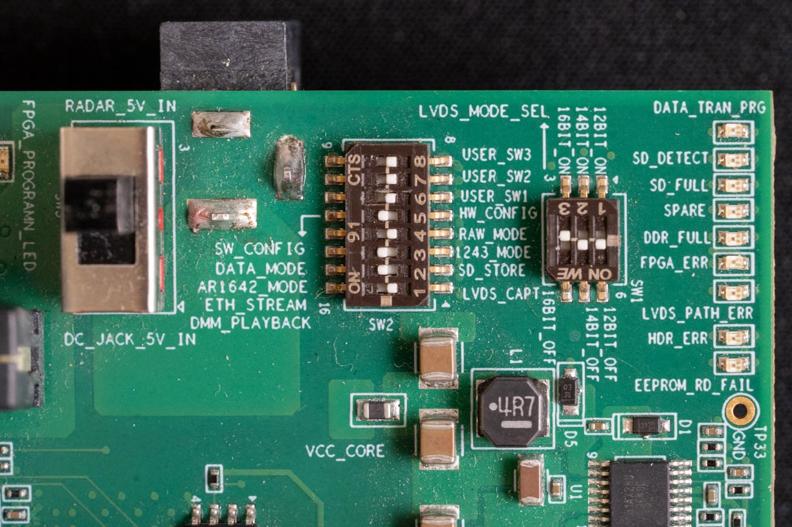

# Hardware Setup

!!! abstract "TL;DR"

    A mmWave radar I/Q data collection system consists of two parts:

    1. A radar with a Low Voltage Differential Signaling (LVDS) debug port which dumps out raw data, and
    2. A capture card which translates these LVDS signals into ethernet packets.

    To use these components with our [`radar`][xwr.radar] and [`capture`][xwr.capture] interfaces, the radar needs to be flashed with firmware with LVDS streaming enabled, while the capture cards need to be configured to read the output signals.

All supported radars follow the same basic procedure: set the radar's SOP pins to flashing mode, flash the demo firmware, and then set the SOP pins back to functional mode. The radars are grouped into families with similar setup instructions.

| Radar | Family | SDK | Flashing Tool | Power | SOP Pins |
| ----- | ------ | --- | ------------- | ----- | -------- |
| [AWR1843Boost / IWR1843Boost](xwr1642-1843.md#awr1843boost) | [XWR1642/1843](xwr1642-1843.md) | mmWave SDK | UniFlash | 5V | DIP switches |
| [AWR1642Boost](xwr1642-1843.md#awr1642boost) | [XWR1642/1843](xwr1642-1843.md) | mmWave SDK | UniFlash | 5V | Jumpers |
| [AWR1843AOP](xwr1642-1843.md#awr1843aop) | [XWR1642/1843](xwr1642-1843.md) | mmWave SDK | UniFlash | 5V | DIP switches |
| [AWR2944EVM](awr2x44p.md) | [AWR2X44(P)](awr2x44p.md) | mmWave MCU Plus SDK | UniFlash | 12V | Jumpers |
| [AWR2944PEVM](awr2x44p.md) | [AWR2X44(P)](awr2x44p.md) | mmWave MCU Plus SDK | `uart_uniflash.py` | 12V | Jumpers |
| [AWR2E44PEVM](awr2x44p.md) | [AWR2X44(P)](awr2x44p.md) | mmWave MCU Plus SDK | `uart_uniflash.py` | 12V | Jumpers |
| [AWRL6844EVM](awrl68xx.md) | [AWRL68XX](awrl68xx.md) | mmWave L-SDK | UniFlash (Windows) | — | DIP switches |
| [AWRL6888EVM](awrl68xx.md) | [AWRL68XX](awrl68xx.md) | mmWave L-SDK | UniFlash (Windows) | 5V-12V | DIP switches |

## DCA1000EVM Capture Card

!!! danger "ESD Sensitive"

    In our experience, the DCA1000EVM is particularly fragile; be careful with electrostatic discharge (ESD).

{: style="width: 50%"}

Ensure that the following DIP switches are set:

- SW2.5: `SW_CONFIG`
- SW2.6: `USER_SW1` (the marked right side), unless the EEPROM is messed up from a misconfigured [`configure_eeprom`][xwr.capture.DCA1000EVM.configure_eeprom] call.

The `DC_JACK_5V_IN` (the large switch on the side) should also be set, depending on whether the FPGA will be powered via the DC jack or via the radar.

!!! tip

    For the AWR1843Boost and AWR1642Boost, setting the large power switch to `RADAR_5V_IN` allows a single power supply connected to the radar to power the entire system.

??? info "Hardware Configuration Switches (Optional)"

    The following are configured by [`configure_fpga`][xwr.capture.DCA1000EVM.configure_fpga] under normal operation, but can be manually set in case that isn't working:

    - SW1: 16-bit mode (`16BIT_ON`, `14BIT_OFF`, `12BIT_OFF`).
    - SW2.1: `LVDS_CAPTURE`
    - SW2.2: `ETH_STREAM`
    - SW2.3: `AR1642_MODE` (2-lane LVDS)
    - SW2.4: `RAW_MODE`
    - SW2.5: `HW_CONFIG`
