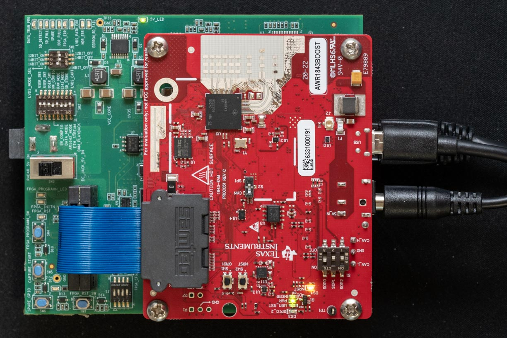
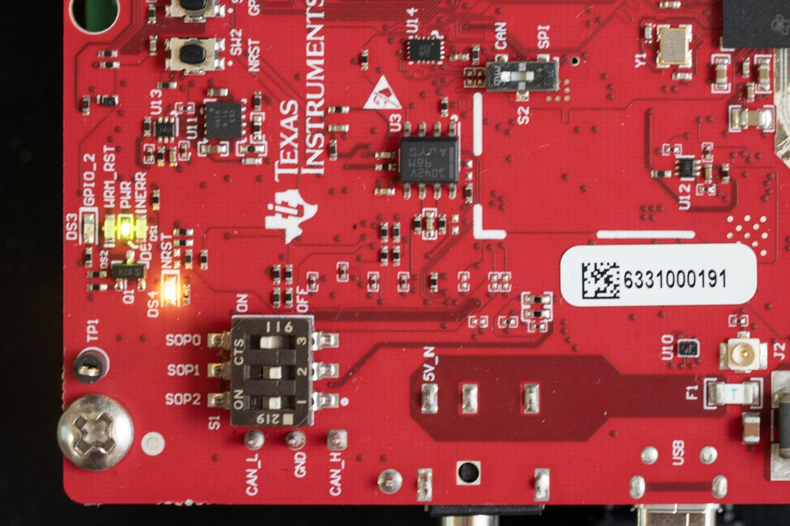
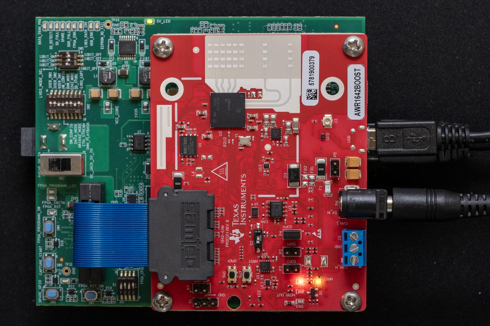
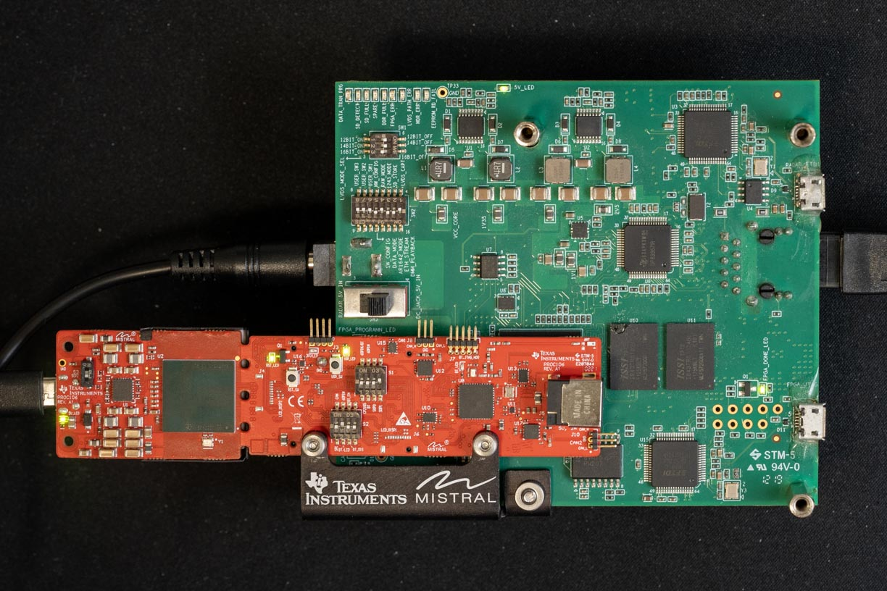
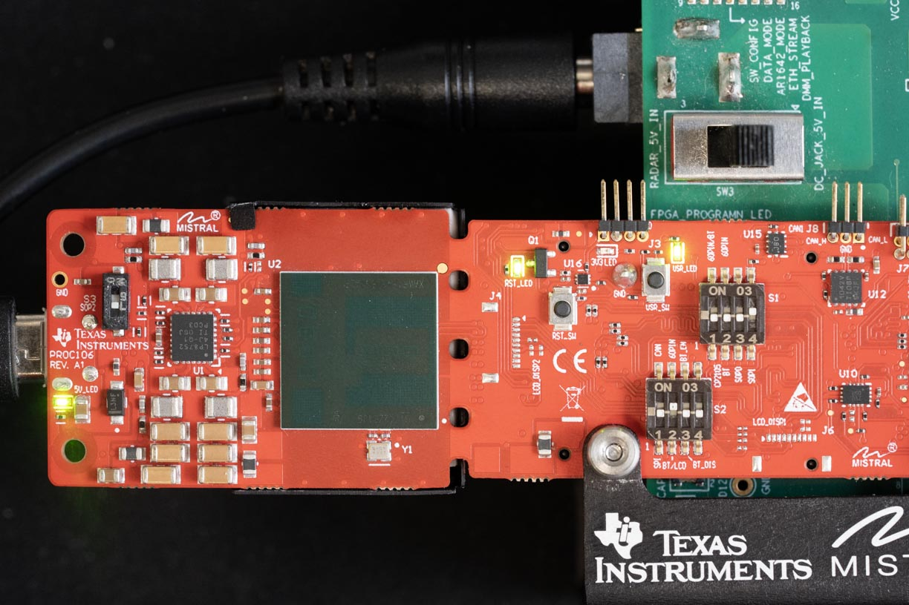

# XWR1642/1843

After installing the [mmWave SDK](https://www.ti.com/tool/MMWAVE-SDK), the firmware can be found at the following paths in the install directory:

| Radar | Firmware | UniFlash Device | Serial Port |
| ----- | -------- | --------------- | ----------- |
| AWR1843Boost | `demo/xwr18xx/mmwave/xwr18xx_mmw_demo.bin` | `AWR1843Boost` | `XDS110 Class Application/User UART` |
| AWR1642Boost | `demo/xwr16xx/mmwave/xwr16xx_mmw_demo.bin` | `AWR1642Boost` | `XDS110 Class Application/User UART` |
| AWR1843AOP | `demo/xwr18xx/mmwave/xwr18xx_mmw_aop_demo.bin` | `AWR1843` | `Silicon Labs Dual CP2105 USB to UART Bridge: Enhanced` |

1. Prepare for flashing.

    - Connect a micro-USB cable to the port on the radar, and power the radar on by connecting its power supply.
    - Set the radar to flashing mode (`SOP2:0=101` on the AWR1843Boost and AWR1642Boost); see the radar-specific instructions below.

2. Flash using [TI UniFlash](https://www.ti.com/tool/UNIFLASH).

    !!! note

        UniFlash seems to work most reliably on Windows.

    - UniFlash should automatically discover the radar. If not, select the device listed above.
    - Select the firmware image listed above to flash.
    - Choose the serial port corresponding to the radar (listed above).
    - Flashing should take around 1 minute, and terminate with "Program Load completed successfully".

    ??? failure "`Not able to connect to serial port. Recheck COM port selected and/or permissions.`"

        If the SOP switches (or `S2` on the AWR1843Boost) are not in the correct position, flashing will fail with
        ```
        Not able to connect to serial port.
        Recheck COM port selected and/or permissions.
        ```

3. Set the radar to functional mode: `SOP2:0=001` on the AWR1843Boost and AWR1642Boost. For the AWR1843AOP, see its switch positions below.

    !!! note

        mmWave Studio expects the radar to be in *debug* mode (`SOP2:0=011`), so switching between `xwr` and mmWave Studio requires the position of the SOP switches to be changed. This is also why mmWave Studio requires the MSS firmware to be "re-flashed" whenever the radar is rebooted.

## AWR1843Boost / IWR1843Boost { #awr1843boost }

<div class="grid" markdown>





</div>

The IWR1843Boost is identical to the AWR1843Boost, and uses the same instructions.

**Prepare for flashing.**

- Find `SOP2:0` (DIP switches on the front of the radar). Set the switches to `SOP2:0=101`, where 1 corresponds to the "on" position labeled on the PCB.
- Find switch `S2` in the middle of the radar, and set it to `SPI` (lower position).

## AWR1642Boost

{: style="width: 50%"}

**Prepare for flashing.**

- Find `SOP2:0`, and short SOP0 and SOP2 (`SOP2:0=101`). These are physical jumpers, which must be shorted using jumper caps or wires.

## AWR1843AOP

<div class="grid" markdown>





</div>

The AWR1843AOP differs from the other XWR1642/1843 radars in a few ways:

- The micro-USB cable is sufficient to power the radar for flashing; the additional power supply is not needed.
- The serial port is provided by a CP2105 USB to UART bridge instead of an XDS110, which requires additional drivers.

??? warning "[CP2105 drivers](https://www.silabs.com/products/development-tools/software/usb-to-uart-bridge-vcp-drivers) must be installed to flash the radar."

    As per the AWR1843AOPEVM [user manual](https://www.ti.com/lit/pdf/spruix8), the CP2105 drivers must be installed to access the UART port during the flashing process.

    If these drivers are not (properly) installed, the serial ports will appear as an "Enhanced Com Port" and "Standard Com Port" with a warning icon in the windows device manager.

    Download and install the drivers [here](https://www.silabs.com/products/development-tools/software/usb-to-uart-bridge-vcp-drivers): after downloading, go to
    ```
    device manager > Standard / Enhanced Com Port > Update Drivers > Browse my computer for drivers
    ```
    then select the folder containing the drivers you downloaded. You may need to do this twice: once for the "Enhanced Com Port", and once for the "Standard Com Port".

**Prepare the radar for flashing.**

- Connect a micro-USB cable to the port on the radar. The additional power supply is not needed for this step.
- Set the DIP switches to the following positions, where on is up:

    |    | 1   | 2   | 3   | 4   |
    | -- | --- | --- | --- | --- |
    | S1 | any | any | OFF | OFF |
    | S2 | any | any | any | any |
    | S3 | ON  |     |     |     |

**Flash using TI UniFlash.**

!!! warning

    Make sure the DCA1000EVM capture card, if connected, is not powered on. If the capture card is powered, flashing will fail with `Received Unexpected Data`.

**Set the radar to functional, DCA1000EVM mode.**

- DIP Switch 2 (center), position 2 should be on (up). All other switches should be off (down).

    |    | 1   | 2   | 3   | 4   |
    | -- | --- | --- | --- | --- |
    | S1 | OFF | any | OFF | OFF |
    | S2 | OFF | ON  | any | any |
    | S3 | OFF |     |     |     |
